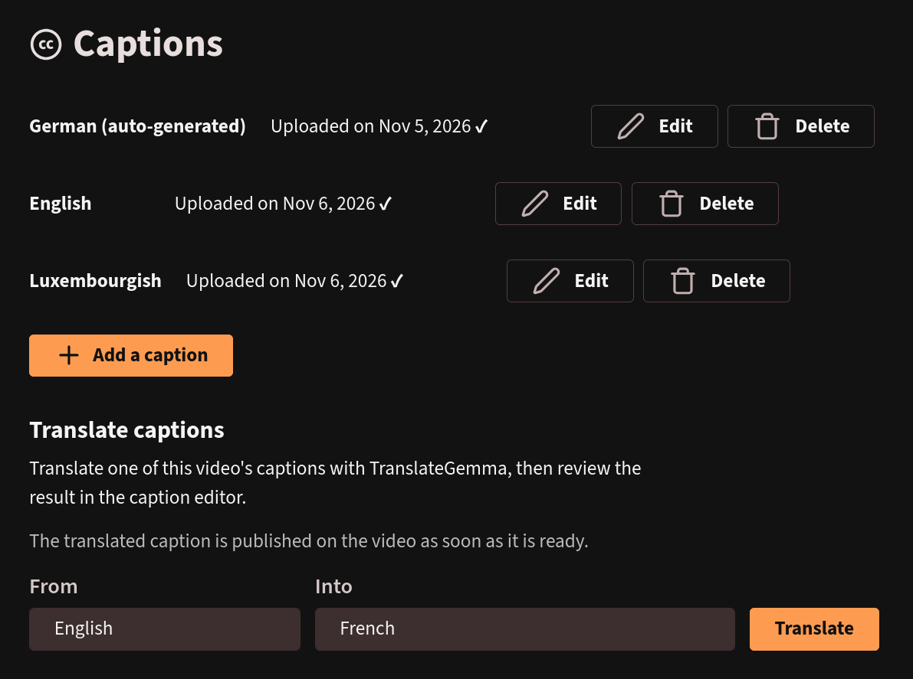

# PeerTube subtitle translator v2

Adds a *Translate captions* section to a video's captions page (`/videos/manage/:id/captions`).
It translates one of the video's existing captions into another language with
[TranslateGemma](https://arxiv.org/abs/2601.09012) and saves the result as a new caption, which
can then be reviewed and fixed in PeerTube's native caption editor.

It replaces [peertube-plugin-subtitle-translator](https://github.com/lmddc-lu/peertube-plugin-subtitle-translator)
(v1, OPUS-MT backend with its own editor page). Both are separate plugins: v2 does not read v1's
settings or data.

Requires PeerTube >= 8.3.0.

## Backend

The plugin calls `POST {base URL}/chat/completions` on any OpenAI-compatible API serving a
TranslateGemma model (for example Ollama, directly or behind a gateway). No custom backend is
needed.

## Settings

| Setting | Effect |
| --- | --- |
| Translation API base URL | Base URL of the OpenAI-compatible API, e.g. `https://llm.example.com/v1`. |
| Translation API key | Optional. Sent as `Authorization: Bearer <key>`. |
| Translation model | Name of the TranslateGemma model, as listed by the API. |
| Target languages | Comma-separated PeerTube language codes offered as targets. Defaults to the 55 languages TranslateGemma was evaluated on (from English). |

## How it works

- Only the video owner and users allowed to update any video (moderators, administrators) can
  translate its captions.
- The browser sends the source caption to the plugin, which groups cues into sentences,
  translates them in batches of a few consecutive sentences, and spreads each translation back
  over the original cues. Cue count and timings stay those of the source. Markup tags (italics,
  voice tags) are not carried over.
- Progress is shown in the caption list. When the job completes, the browser uploads the caption
  with the user's session. It is published on the video right away, not when the page is saved.
- Failures show a short status in the page. Details (API URL, upstream answers) stay in the
  PeerTube server log.

## Install

See the [installation instructions](docs/index.md#installation) in the documentation.

## Development

See the [development notes](docs/index.md#development) in the documentation.

## License

[AGPL-3.0](LICENSE)
