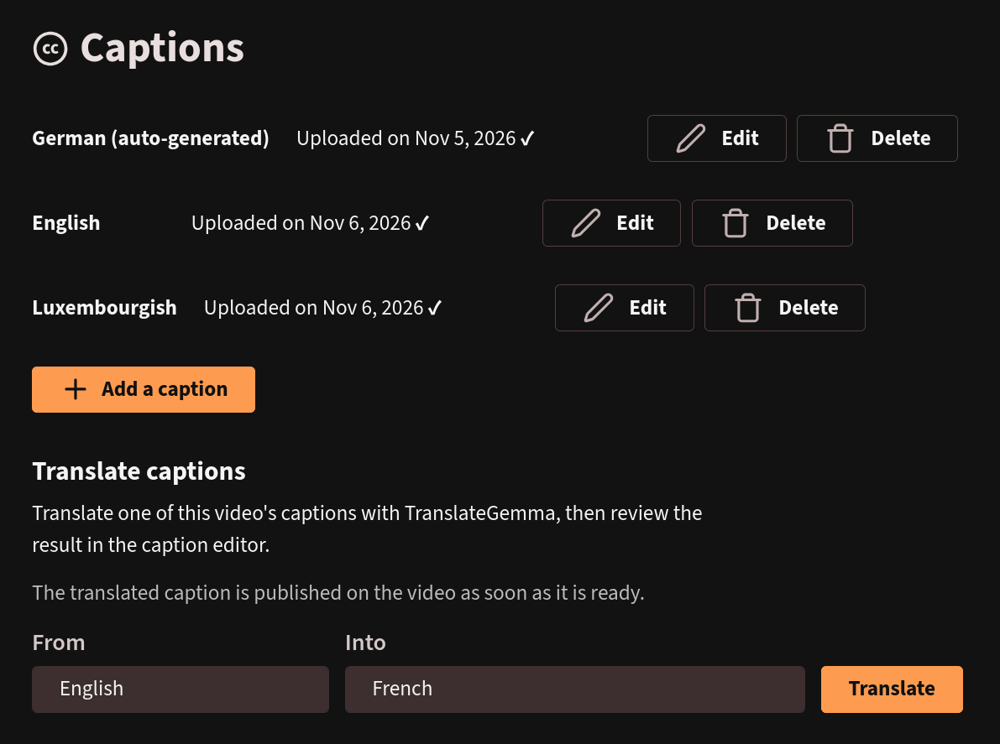

# Peertube plugin subtitle translator v2

This plugin adds a *Translate captions* section to a video's captions page (`/videos/manage/:id/captions`).
It translates one of the video's existing captions into another language with
[TranslateGemma](https://arxiv.org/abs/2601.09012) and saves the result as a new caption, which
can then be reviewed and fixed in PeerTube's native caption editor.



Source code:

- [github.com/lmddc-lu/peertube-plugin-subtitle-translator-v2](https://github.com/lmddc-lu/peertube-plugin-subtitle-translator-v2)
- [git.skilltech.dev/platform/tools/peertube/peertube-subtitle-translator-v2](https://git.skilltech.dev/platform/tools/peertube/peertube-subtitle-translator-v2)

It replaces the archived [peertube-plugin-subtitle-translator](https://github.com/lmddc-lu/peertube-plugin-subtitle-translator)
(v1, OPUS-MT backend with its own editor page). Both are separate plugins: v2 does not read v1's
settings or data.

Requires PeerTube >= 8.3.0.

## Backend

The plugin calls `POST {base URL}/chat/completions` on any OpenAI-compatible API serving a
TranslateGemma model (for example Ollama, directly or behind a gateway). No custom backend is
needed.

## Installation

Clone the repository in a directory accessible by your PeerTube instance, then build the plugin:

```bash
git clone https://github.com/lmddc-lu/peertube-plugin-subtitle-translator-v2.git
cd peertube-plugin-subtitle-translator-v2/
npm ci
npm run build
```

Then install it into your PeerTube instance:

```bash
peertube-plugins install --path /path/to/peertube-plugin-subtitle-translator-v2
```

Where the path is the path on your server where the plugin is located.

## Configuration

Once the plugin is installed, configure it in the PeerTube admin panel. The settings available are:

| Setting | Effect |
| --- | --- |
| Translation API base URL | Base URL of the OpenAI-compatible API, e.g. `https://llm.example.com/v1`. |
| Translation API key | Optional. Sent as `Authorization: Bearer <key>`. |
| Translation model | Name of the TranslateGemma model, as listed by the API. |
| Target languages | Comma-separated PeerTube language codes offered as targets. The default lists the languages TranslateGemma was evaluated on (translated from English), plus English and Luxembourgish. |

## Usage

- Only the video owner and users allowed to update any video (moderators, administrators) can
  translate its captions.
- On a video's captions page, the *Translate captions* section lists the video's captions as
  sources and the configured target languages.
- The browser sends the source caption to the plugin, which groups cues into sentences,
  translates them in batches of a few consecutive sentences, and spreads each translation back
  over the original cues. Cue count and timings stay those of the source. Markup tags (italics,
  voice tags) are not carried over.
- Progress is shown in the caption list. When the job completes, the browser uploads the caption
  with the user's session. It is published on the video right away, not when the page is saved.
- Failures show a short status in the page. Details (API URL, upstream answers) stay in the
  PeerTube server log.

## Development

`npm run build` compiles the server (`tsconfig.json`) and the client script
(`tsconfig.client.json`). `npm run stage` builds and unpacks the npm package into
`.staging/peertube-plugin-subtitle-translator-v2`, a directory that can be mounted into a
PeerTube container and installed with `npm run plugin:install -- --plugin-path <path>`.

Client scripts are served under the plugin version with immutable caching, so after reinstalling
the same version, force-reload the script in the browser or bump the version.

Translations of the settings and the panel are in `languages/` (French, German).
